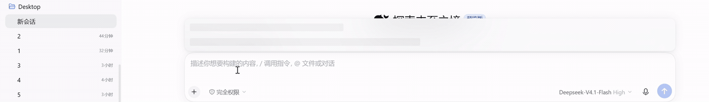
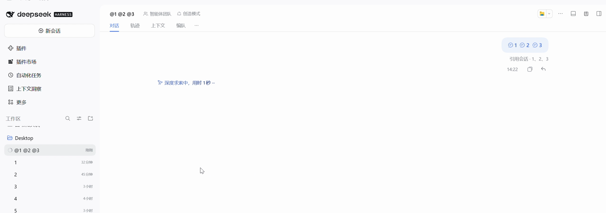
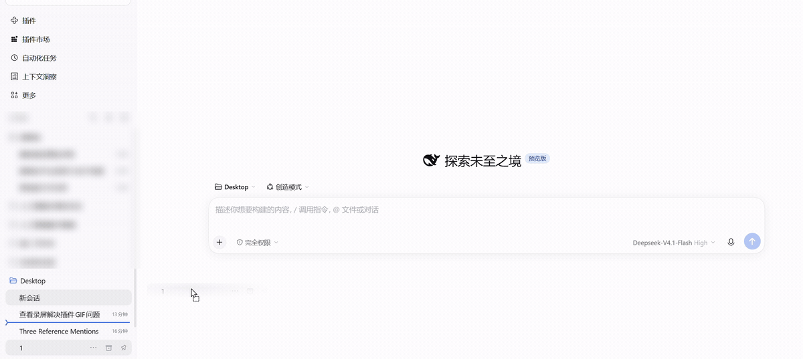

# dsh-drag-graft · drag a conversation into the composer

Drag a conversation row from the DSH sidebar onto the chat area and it lands in the composer as a
**native session-reference chip** — then keep typing and send one message that carries both the
reference and your question.

- No persistent UI: no buttons, no drop bar, no floating panel.
- Silent on success (the extra chip is the feedback); only failures flash one line at the bottom.
- Never edits host files, never touches the network, never sends a message (except the documented fallback below).

[中文 README](README.md)



Three drags in a row, then send — the message carries "referenced sessions · 1, 2, 3". Real DSH window,
recorded at normal speed with the drags left intact:



A second recording runs the whole loop — drop a reference, type the body, send, and the message header
reads "referenced sessions · 1" (the sidebar's workspace list is blurred):



---

## Quick start (install and go)

**A. Ask the agent inside DSH**

```
plugin_manager { action: "install_bundle", target: "dsh-drag-graft" }
```

**B. CLI**

```powershell
dsh plugin --profile desktop add dsh-drag-graft
```

**C. Settings panel** — DSH → Settings → Plugins → Install → `dsh-drag-graft` → reload the page.

Then reload the page and:

1. drag **another** conversation row out of the sidebar,
2. drop it on the conversation area,
3. a blue chip appears in the composer (same node you get from the `@` menu),
4. keep typing → press Enter.

30-second self-check: press F12 and run `__dragGraft.state()`. You should see
`{ currentSessionId: "session-…", hasInputTriggers: true, hasInputActions: true, limits: { maxReferences: 3, … } }`.

---

## Behaviour

| Action | Result |
|---|---|
| Drag another conversation onto the chat area | A reference chip is inserted; keep editing, then send |
| Drag several conversations in a row | Multiple chips (limit below) |
| Drag a **workspace (folder) row** onto the chat area | Inserts that folder's path reference, e.g. `@C:/Users/you/Desktop/` (quoted automatically when the path contains spaces) |
| Drag the **current** conversation | Blocked with a notice (the host rejects self-references: `cannot reference itself`) |
| Drop inside the **sidebar** | Never intercepted: official reordering and `dsh-workspace-mover` keep working |
| Drag a **file** | Never intercepted: host upload behaviour is untouched |
| Target not found among candidates | Nothing is inserted — never picks a random/wrong conversation |

### Dragging a folder

The sidebar row that groups conversations by directory (a workspace) can be dragged too:
drop it on the chat area and the draft gains `@C:/Users/you/Desktop/` — that directory,
handed to the model.

- The inserted form is an **absolute path** (trailing slash, quoted when it contains
  whitespace), because a relative path means nothing across workspaces.
- It goes through the host's own `inputActions.insertText`, so it is one undoable edit
  like typing it yourself — no candidate menu involved.
- Drops **inside the sidebar** are never intercepted: that is the host's reordering.
- Folders dragged in from the OS file manager are not touched; the host upload pipeline
  keeps them.

### How many references per message?

The cap lives in the **host** (`@deepseek-ai/dsh-session-reference`, `MAX_REFERENCES`, stock value **3**).
The plugin asks the host for the real value (`draggraft.limits`) and follows it:

- Stock host: **3** — the plugin blocks the 4th drop instead of letting you build a message the host will reject.
- Patched host (e.g. raised to 100): the plugin relaxes automatically, no plugin change needed.

> Raising the cap means patching the host (`app.asar`), which is out of scope for this plugin.
>
> **You can hand that job to your own agent.** Open a new conversation and paste this:
>
> ```text
> Raise the session-reference cap in the DSH host (@deepseek-ai/dsh-session-reference) from 3 to
> something like 100, so plugins like dsh-drag-graft can carry more conversations per message.
>
> Notes:
> 1. MAX_REFERENCES appears in more than one place: the const, the Config schema's .max(3).default(3),
>    and a hard `> 3` check in the constructor. All three must change; leaving one behind fails with
>    SESSION_REFERENCE_INVALID_CONFIG.
> 2. Repack app.asar afterwards: header layout [4][size][fieldSize][jsonLen][json][pad4], data starts
>    at 8+size, and every file's offset/size and integrity (sha256 + 4MB blocks) must be recomputed.
> 3. DSH must be fully quit before swapping the asar (otherwise it is locked), then start it and probe
>    the listening port as a health check; roll back automatically on failure.
> 4. Every DSH update overwrites app.asar and resets the cap to 3, so make it a repeatable script.
> ```
>
> Nothing to change in this plugin: it re-reads the cap from the host before every insert
> (`__dragGraft.refreshLimits()` forces a re-read).

### Fallback

If the internal insert API stops working (host upgrade), the plugin **degrades to sending a
reference-only message** (the blue reference appears in the chat) and leaves the composer clean.
Deliberate: better a missing chip than a silent failure.

---

## Troubleshooting

Console helpers (F12):

| Question | Command |
|---|---|
| Is the plugin alive? | `__dragGraft.state()` |
| What limit did the host report? | `__dragGraft.limits()` |
| Current insertion point (detect coords + draftRev) | `__dragGraft.span()` |
| How many session references are already in the draft? | `__dragGraft.refCount()` |
| Insert once manually | `__dragGraft.insert("<session-id>", "title")` |
| Re-read the host limit | `__dragGraft.refreshLimits()` |

| Symptom | Cause | Fix |
|---|---|---|
| Drop does nothing | self-reference / cap reached / target not in candidates | check the toast and `state()` |
| "no official insertion point" | host did not pass `inputActions` | falls back to sending; upgrade/downgrade DSH or file an issue |
| Only the first chip inserts | old bug (fixed in 2.0.2) | upgrade to ≥ 2.1.0 |
| Turn fails: `cannot reference itself` | old bug (fixed in 2.0.1) | upgrade |
| Turn fails: `may reference at most N sessions` | host cap exceeded | split into several messages, or use `graft_forward` |
| Blank page | plugin half threw (fail-soft in place) | use the desktop "disable third-party plugins and restart" escape hatch |

---

## Disable / uninstall

```
plugin_manager { action: "set_bundle", target: "dsh-drag-graft", enabled: false }
plugin_manager { action: "remove_bundle", target: "dsh-drag-graft" }
```

CLI: `dsh plugin --profile desktop remove dsh-drag-graft`

---

## Privacy

- **No network**: zero requests.
- **No file access**: only the public `sessions` / `inputTriggers` services.
- **Host half is read-only**: no sessions created, no files written, no messages sent. It exposes two read-only RPCs (`draggraft.limits`, `draggraft.transcript`) and one diagnostic tool (`draggraft_probe`).
- Never bypasses permissions: everything it does is something you could do in the UI yourself.

---

## How it works (internal APIs — may break on upgrade)

The composer is a **Lexical** editor: DOM writes, `execCommand` and synthetic `paste` never reach its
state, so "type `@` programmatically" is a dead end.

| Step | API | Why |
|---|---|---|
| 1 | `ctx.inject(['inputTriggers'])` | the `@` trigger service (must come from `ctx.inject`, not `ctx.get`) |
| 2 | `controller.toggleSource('reference', hit)` | opens the reference candidates with a synthetic hit, no typing |
| 3 | `controller.pick('reference', index)` | → `settle()` → `execute()` → official `slash/input-insert-reference` |
| 4 | `inputActions.captureInsertion()` | slot prop returning **detect coordinates + current draftRev**, the CAS input of `insertReference` |

Two details that cost us bugs:

- **Coordinates must be detect coordinates**: a chip is a single placeholder there, not its label; using `textContent.length` as the caret breaks as soon as a chip exists → the second drop never inserts.
- **draftRev must be fresh**: every edit bumps it; a guessed revision is rejected by CAS.

## Compatibility

| Host | Status |
|---|---|
| DSH Desktop `0.2.1-rc.3` (Electron 44 / Chrome 152) | verified end-to-end |
| Older lines | untested, `engines.dsh` refuses |
| Future versions | internal API changes degrade to "send a reference message", never crash |

## Development

```powershell
npm run check   # syntax + manifest/contract/behaviour tests (node --test, 20 tests)
```

The behaviour tests boot `client.js` against a minimal DOM/React/host stub and cover: self-reference
guard, no blind picking, multiple chips, limit following the host, file references not counting.

## Difference from `@mars.liu/dsh-graft`

| | dsh-drag-graft | @mars.liu/dsh-graft |
|---|---|---|
| Shape | drag → native chip in the draft | 🌱 toggle + per-turn selection + forward |
| Effect | host compresses the other session (64KB default) into context | writes selected turns as a `<graft>` message |
| UI | none | buttons and a selection bar |
| Best for | letting the model know what that conversation said, while you keep typing | exact turn slices as raw text |

They coexist: different slots, no drag-event conflicts.

MIT License.
